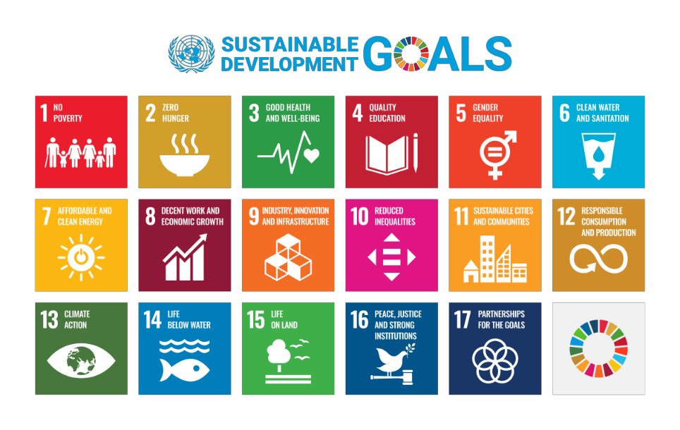

# BUKU PANDUAN RESPONSI PRAKTIKUM PEMOGRAMAN WEB I

Dokumen dirancang sebagai referensi mekanisme pengerjaan responsi praktikum Pemograman Web I.

JURUSAN INFORMATIKA

FAKULTAS TEKNIK

UNIVERSITAS JENDERAL SOEDIRMAN

PURWOKERTO

2026

## DAFTAR ISI

BAB I ..................................................................................................................... 2
PENDAHULUAN .................................................................................................. 2

1.1 Latar Belakang ........................................................................................... 2
1.2 Tujuan ........................................................................................................ 2
1.3 Ruang Lingkup .......................................................................................... 2
BAB II .................................................................................................................... 4
KETENTUAN PENGERJAAN PROYEK ............................................................ 4

2.1 Pembentukan Kelompok ............................................................................ 4
2.2 Penentuan Tema Proyek ............................................................................ 4
2.3 Ketentuan Implementasi Proyek ................................................................ 5
2.4 Pembagian Tugas ....................................................................................... 5
BAB III ................................................................................................................... 6
PUBLIKASI DAN DOKUMENTASI PROYEK .................................................. 6

3.1 Presentasi dan Video Presentasi ................................................................ 6
3.2 Repository GitHub ..................................................................................... 6
3.3 Project Showcase ....................................................................................... 6
3.4 Ketentuan Unggah di Media Sosial ........................................................... 7
BAB IV .................................................................................................................. 8
PENGUMPULAN DAN BATAS WAKTU .......................................................... 8

4.1 Hasil Akhir yang Dikumpulkan ................................................................. 8
4.2 Batas Waktu ............................................................................................... 8
BAB V PENUTUP ................................................................................................. 9

# BAB I
PENDAHULUAN

## 1.1 Latar Belakang

Responsi 2 merupakan Proyek Akhir pada Praktikum Pemrograman Web 1. Pada tahap ini, peserta praktikum menerapkan seluruh materi yang telah dipelajari ke dalam sebuah aplikasi web yang utuh, terintegrasi, dan dikerjakan secara berkelompok.

Proyek akhir tidak hanya menilai kemampuan teknis dalam menulis kode, tetapi juga kemampuan merancang logika bisnis, mengintegrasikan berbagai modul, bekerja sama dalam tim, serta mengomunikasikan hasil pekerjaan kepada pihak lain. Oleh karena itu, setiap kelompok diminta tidak hanya membangun aplikasi, tetapi juga mendokumentasikan, mempresentasikan, dan mempublikasikan hasilnya.

Proyek yang dikembangkan wajib relevan dengan Sustainable Development Goals (SDGs), yaitu 17 tujuan pembangunan berkelanjutan. Dengan ketentuan ini, aplikasi yang dibuat diharapkan berangkat dari suatu permasalahan, memiliki tujuan dan manfaat yang jelas, serta tidak berhenti sebagai latihan teknis semata.

Demi pelaksanaan responsi berjalan tertib dan seragam bagi seluruh kelompok, diperlukan pedoman yang menjelaskan mekanisme dan ketentuan pengerjaan secara jelas. Laporan ini disusun sebagai pedoman tersebut..

## 1.2 Tujuan

Tujuan umum laporan ini adalah menjelaskan mekanisme dan ketentuan Responsi 2 secara menyeluruh, sehingga setiap kelompok memahami kewajiban, keluaran, dan batas waktu pengerjaan proyek akhir. Secara khusus, laporan ini bertujuan untuk:

1. Menjelaskan ketentuan pembentukan kelompok, penentuan tema proyek, implementasi proyek, dan pembagian tugas
2. Menjelaskan kewajiban presentasi, video presentasi di YouTube, repository GitHub, dan Project Showcase, termasuk ketentuan unggahan di media sosial
3. Menjelaskan komponen hasil akhir yang wajib dikumpulkan beserta batas waktu pengumpulannya

## 1.3 Ruang Lingkup

Ruang lingkup laporan ini meliputi sembilan ketentuan, yaitu pembentukan kelompok, penentuan tema proyek, implementasi proyek, pembagian tugas, presentasi dan publikasi proyek, repository GitHub, Project Showcase, pengumpulan hasil akhir, serta batas waktu pengerjaan.

# BAB II
KETENTUAN PENGERJAAN PROYEK

## 2.1 Pembentukan Kelompok

1. Setiap kelompok terdiri atas 3 (tiga) orang.
2. Kelompok **ditentukan oleh asisten praktikum**.

## 2.2 Penentuan Tema Proyek

*Gambar 1. Daftar 17 SDGS*

Sustainable Development Goals (SDGs) atau Tujuan Pembangunan Berkelanjutan adalah suatu agenda 2030 yang telah disepakati bersama oleh semua Negara Anggota Perserikatan Bangsa-Bangsa (PBB) pada tahun 2015. Agenda ini memberikan cetak biru bersama untuk perdamaian dan kemakmuran bagi manusia dan lingkungan, saat ini dan di masa depan.

Dalam Responsi ini, SDGs dipakai sebagai landasan pemilihan tema. Dengan cara ini, diharapkan praktikan bisa belajar bahwa teknologi web dapat digunakan untuk menjawab persoalan nyata di masyarakat, bukan hanya untuk membangun aplikasi tanpa tujuan yang jelas.

Berikut adalah ketentuan penggunaan tema untuk proyek akhir.

1. Setiap kelompok wajib **menentukan tema proyek akhir** yang relevan dengan SDGs.
2. Tema dapat **mengangkat salah satu atau beberapa tujuan dari 17** **tujuan SDGs**.
3. Proyek harus memiliki latar belakang permasalahan, tujuan, serta manfaat yang jelas.

## 2.3 Ketentuan Implementasi Proyek

1. Setiap kelompok wajib mengimplementasikan minimal 9 (sembilan) modul yang mendukung logika bisnis aplikasi.
2. Setiap modul harus menerapkan fitur-fitur yang telah dipelajari selama praktikum Pemrograman Web 1.
3. Modul dan fitur harus saling terintegrasi serta mendukung fungsi utama aplikasi.
4. Seluruh fitur wajib berjalan dengan baik dan didemonstrasikan pada saat presentasi.

## 2.4 Pembagian Tugas

1. Setiap kelompok wajib membagi peran dan tanggung jawab kepada masing-masing anggota.
2. Setiap anggota wajib berkontribusi aktif dalam proses pengembangan proyek.
3. Setiap anggota harus memahami keseluruhan proyek, bukan hanya bagian yang menjadi tanggung jawabnya.

# BAB III
PUBLIKASI DAN DOKUMENTASI PROYEK

## 3.1 Presentasi dan Video Presentasi

Setiap kelompok wajib mempresentasikan proyek akhir secara ***online***, membuat video presentasi, dan mengunggahnya ke YouTube dengan durasi **minimal 7 menit** dan dikumpulkan sebelum batas waktu berakhir. Seluruh anggota kelompok wajib muncul dan berpartisipasi dalam video. Video presentasi minimal mencakup:

1. Profil atau perkenalan tim;
2. Latar belakang dan permasalahan yang diangkat;
3. Tujuan dan manfaat proyek;
4. Penjelasan modul dan fitur yang diimplementasikan;
5. Demonstrasi hasil akhir aplikasi;
6. Keterkaitan proyek dengan SDGs;
7. Kesimpulan.

## 3.2 Repository GitHub

Setiap kelompok wajib membuat **repository GitHub** yang berisi source code proyek dan bersifat ***public***. Repository wajib dilengkapi berkas README.md yang minimal mencakup:

1. Nama dan deskripsi proyek;
2. Latar belakang dan tujuan proyek;
3. Daftar fitur atau modul yang diimplementasikan;
4. Teknologi yang digunakan;
5. Panduan instalasi dan konfigurasi;
6. Panduan menjalankan aplikasi.

## 3.3 Project Showcase

Setiap kelompok wajib membuat ***Project Showcase*** berupa slide presentasi singkat yang menampilkan gambaran umum proyek. Showcase wajib dibuat **semenarik dan sekreatif** mungkin agar **layak dipublikasikan** melalui media sosial. Konten minimal mencakup:

1. Nama dan identitas aplikasi
2. Latar belakang atau permasalahan yang diangkat
3. Solusi dan manfaat aplikasi
4. Highlight fitur atau modul unggulan
5. Screenshot atau tampilan aplikasi
6. Profil anggota tim
7. Keterkaitan proyek dengan SDGs

Format yang dikumpulkan berupa berkas PDF atau tautan desain yang dapat diakses.

Catatan: Project Showcase bukanlah file yang dipresentasikan, melainkan sebagai file informatif mengenai proyek yang siap dipublikasikan. Sebagai referensi design, kamu bisa mengunjungi link [Contoh Design Project Showcase](https://www.behance.net/gallery/181875611/XPharmacy-A-UXUI-Case-Study).

## 3.4 Ketentuan Unggah di Media Sosial

Selain dikumpulkan kepada asisten, Project Showcase wajib dipublikasikan melalui media sosial dengan ketentuan berikut:

1. Setiap anggota kelompok mengunggah Project Showcase secara mandiri, sehingga untuk satu kelompok terdapat tiga unggahan.
2. Platform yang digunakan adalah salah satu dari Instagram atau LinkedIn. Setiap anggota bebas memilih platform yang dipakai.
3. Konten yang diunggah berasal dari Project Showcase kelompok.
4. Unggahan bersifat publik agar dapat diakses, dan tautan unggahan disimpan sebagai bukti.

# BAB IV
PENGUMPULAN DAN BATAS WAKTU

## 4.1 Hasil Akhir yang Dikumpulkan

Setiap kelompok wajib mengumpulkan tiga komponen berikut, dan memastikan seluruh tautan serta berkas dapat diakses oleh asisten praktikum.

| No | Komponen | Keterangan |
|---|---|---|
| 1 | Link Repository GitHub | Bersifat public dan memuat README.md |
| 2 | Link Video Presentasi | Diunggah ke YouTube |
| 3 | Link Project Showcase | Link Media Sosial yang Digunakan untuk Mengupload Proyek Showcase |

## 4.2 Batas Waktu

Batas waktu pengumpulan proyek akhir adalah **2 (dua) minggu** setelah hari pelaksanaan asistensi, pukul 23.49 WIB.

# BAB V
PENUTUP

Dengan terbitnya laporan ini, setiap kelompok diharapkan memahami mekanisme dan ketentuan Responsi 2 praktikum Pemograman Web I sehingga dapat menyelesaikan proyek akhir secara tertib, tepat waktu, dan sesuai ketentuan yang berlaku.
